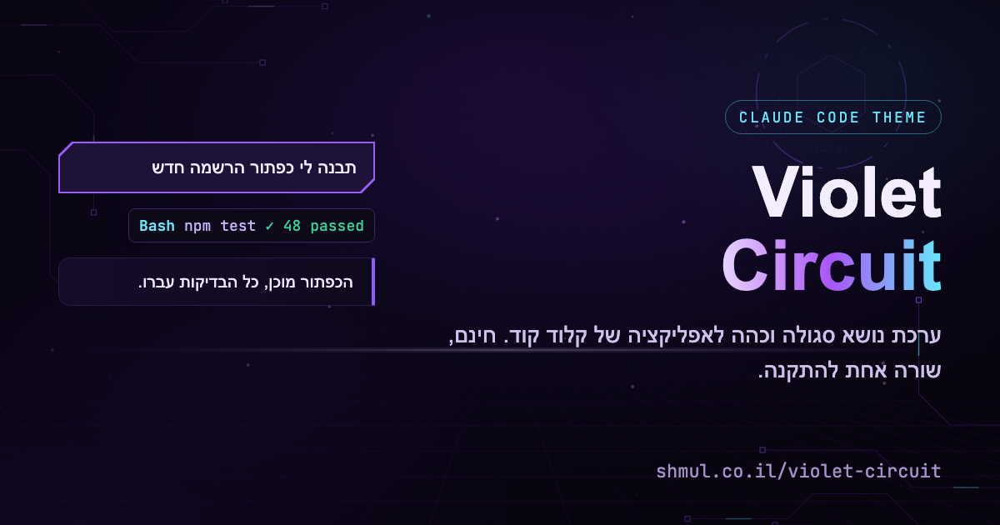

# Violet Circuit



A neon violet tech theme for the Claude Code desktop app, in a dark mode and a light mode.

- **Two modes:** deep violet space in dark mode, pale lavender with the same neon in light mode. Both modes cover the palette, the backdrop and the message cards.
- **Palette:** every surface, text and border in violet, with a neon purple accent and a cyan secondary. Red, green and amber keep their meaning for errors, success and warnings.
- **Live backdrop:** a receding neon grid floor, a breathing horizon line, circuit traces in the corners carrying data pulses, slowly turning rings and drifting motes, all behind frosted dark glass so the text stays readable.
- **Messages:** your messages sit in chamfered cards with a neon outline and corner brackets; replies get a dark card with a violet edge bar; headings in a spaced mono face; tool rows in the code font.
- **Sound:** an optional low synth hum with rare data blips, plus short cues for send, done, ask and error. It plays only after you press the speaker in the session's title bar.

Respects reduced motion: the scene holds still with every part in a resting place.

Showcase: https://www.shmul.co.il/violet-circuit/

## Install

At the prompt of a Claude Code terminal session:

```
/plugin install violet-circuit --marketplace ShmulD/violet-circuit
```

Answer `y` to add the marketplace, then pick the user scope with Enter.

From a shell:

```bash
claude plugin install violet-circuit --marketplace ShmulD/violet-circuit
```

In the desktop app, where `/plugin` does not run: click **+** next to the prompt box, then **Plugins**, **Add marketplace** with `ShmulD/violet-circuit`, then **Add plugin**.

The theme draws in the desktop and mobile apps. The terminal keeps its own look. Open a new session after installing.

## Light and dark

By default the theme follows the app: light when the app is in light mode, dark when it is in dark mode. To pin one mode:

- **Right-click** anywhere in the conversation and pick `Violet Circuit: dark mode`, `Violet Circuit: light mode` or `Violet Circuit: follow the app`.
- Or type a command in the prompt box:

```
/violet dark
/violet light
/violet auto
```

`/violet` on its own flips between dark and light. The choice is remembered for later sessions.

## Uninstall

```bash
claude plugin uninstall violet-circuit
```

## License

MIT, by Shmulik Dorinbaum (https://www.shmul.co.il/).
